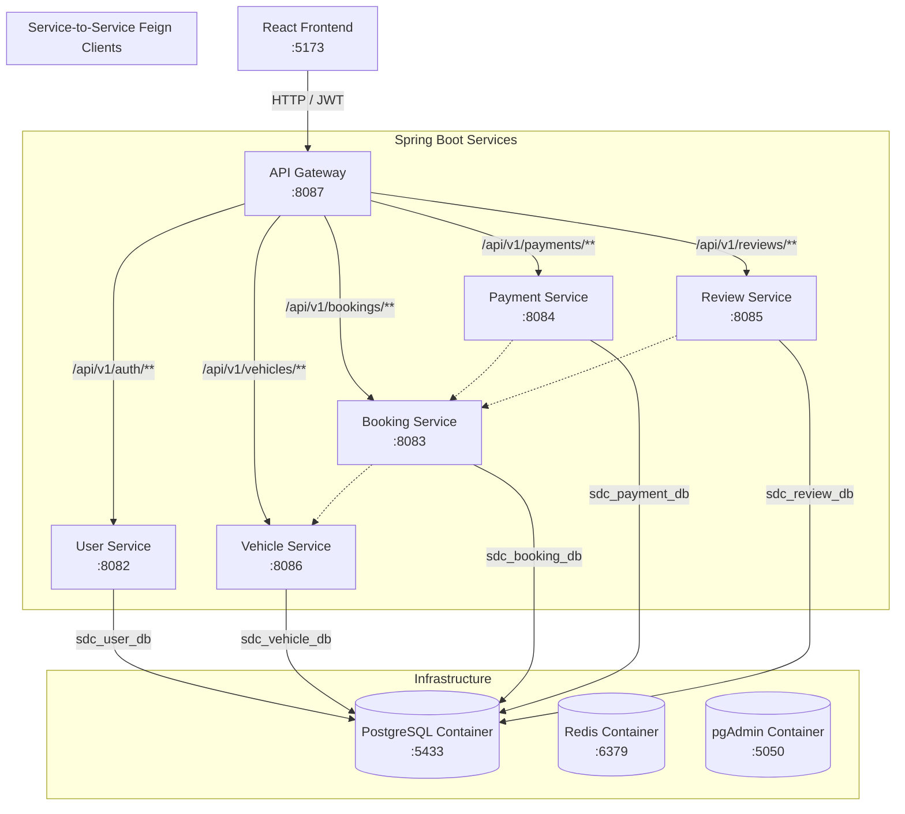

# SelfDriveConnect System Documentation

SelfDriveConnect is a peer-to-peer car rental platform built on a container-first microservice architecture. This document serves as the complete developer and system administrator reference manual.

---

## 🗺️ System Overview & Architecture

The application is designed using decoupled domain microservices communicating over HTTP and secured via JWT authorization. The frontend client routes all communication through a central API Gateway.



---

## ⚙️ Port Map & Service Catalog

| Service Name | Local Port | Key Responsibility | Context Routing Path |
| :--- | :--- | :--- | :--- |
| **`api-gateway`** | `8087` | Central routing gateway, CORS control, JWT validation | `/` |
| **`user-service`** | `8082` | Identity provider, registration, login, role promotion | `/api/v1/auth/**`, `/api/v1/users/**` |
| **`vehicle-service`** | `8086` | Car inventory, search index, verification workflows | `/api/v1/vehicles/**` |
| **`booking-service`** | `8083` | Booking validation, conflict/overlap query checks | `/api/v1/bookings/**` |
| **`payment-service`** | `8084` | Simulated payment processing gateway | `/api/v1/payments/**` |
| **`review-service`** | `8085` | Completed booking verification, review rating metrics | `/api/v1/reviews/**` |
| **`frontend`** | `5173` | React / Vite Single Page Application | `/` |
| **`pgAdmin`** | `5050` | Graphical Database Administration Console | `/` |

---

## 🗄️ Database Strategy & Operations

SelfDriveConnect implements the **Database-per-Service** pattern. All databases reside within a single PostgreSQL container.

### Databases list
*   `sdc_user_db` (User credentials, profile info, roles mapping)
*   `sdc_vehicle_db` (Vehicle inventory records, status flags)
*   `sdc_booking_db` (Rentals schedule log)
*   `sdc_payment_db` (Receipts and transactions status ledger)
*   `sdc_review_db` (User feedback and ratings statistics)

---

### How to Inspect the Databases

#### Option A: Using pgAdmin (GUI)
1. Navigate to [http://localhost:5050](http://localhost:5050) in your browser.
2. Log in using the default administrator credentials:
   *   **Username (Email)**: `admin@sdc.com`
   *   **Password**: `admin`
3. Connect pgAdmin to your PostgreSQL service container:
   *   Right-click **Servers** $\rightarrow$ **Register** $\rightarrow$ **Server...**
   *   **General tab**: Enter a name (e.g. `SelfDriveConnect`).
   *   **Connection tab**:
       *   **Host name/address**: `postgres` (or `sdc-postgres`)
       *   **Port**: `5432`
       *   **Maintenance database**: `sdc_vehicle_db`
       *   **Username**: `sdc_user`
       *   **Password**: `sdc_pass`
   *   Click **Save**.

#### Option B: Using the Command Line (CLI)
You can directly run interactive database console shells or SQL queries from your local terminal using the Docker PostgreSQL wrapper commands:

*   **List all registered user accounts**:
    ```bash
    docker exec -it sdc-postgres psql -U sdc_user -d sdc_user_db -c "SELECT id, email, full_name FROM users;"
    ```
*   **Query active user roles**:
    ```bash
    docker exec -it sdc-postgres psql -U sdc_user -d sdc_user_db -c "SELECT * FROM user_roles;"
    ```
*   **Query active vehicle listings**:
    ```bash
    docker exec -it sdc-postgres psql -U sdc_user -d sdc_vehicle_db -c "SELECT id, brand, model, status FROM vehicles;"
    ```
*   **Open a live PostgreSQL shell directly inside a database container**:
    ```bash
    docker exec -it sdc-postgres psql -U sdc_user -d sdc_user_db
    ```
    *(To close the prompt, input `\q` and press Enter)*

---

## 🔒 Security & Role Framework

### Authorization Protocol
*   **State-Free Authentication**: Only the `user-service` is responsible for generating JWT signatures.
*   **Decoupled Verification**: Resource microservices (`booking-service`, `vehicle-service`, etc.) parse and check token signatures using a shared HMAC key (`jwt.secret`), completely eliminating chatty user validation API calls.
*   **Server-Side Security**: Downstream services fetch user context properties (like `ownerId` or `renterId`) directly from the incoming token context properties, mitigating request modification security issues.

### Roles Matrix
*   **`RENTER`**: Can search listings, schedule bookings, perform payments, and write reviews.
*   **`OWNER`**: Can register vehicles, view dashboard panels, and confirm/complete vehicle rental bookings.
*   **`ADMIN`**: Can review, activate, or suspend car listings across the system.

### Account Promotions

#### Promoting a User to ADMIN (Direct Database SQL Query)
You can directly promote any user ID to `ADMIN` inside the database. For example, to grant `ADMIN` status to user ID `1` (`thimmapuramravi9951@gmail.com`):
```bash
docker exec -it sdc-postgres psql -U sdc_user -d sdc_user_db -c "INSERT INTO user_roles (user_id, roles) VALUES (1, 'ADMIN');"
```

#### Promoting a User via HTTP API
An existing platform administrator can grant the `ADMIN` role to another user dynamically:
```powershell
$roleUpdate = @{ roles = @("OWNER", "RENTER", "ADMIN") } | ConvertTo-Json
Invoke-RestMethod -Uri "http://localhost:8087/api/v1/users/{userId}/roles" -Method Patch -Body $roleUpdate -ContentType "application/json" -Headers @{ Authorization = "Bearer {ADMIN_JWT_TOKEN}" }
```

---

## 🌐 API Gateway CORS Configuration

To prevent web browser CORS issues arising from duplicate response headers injected by the Gateway and downstream microservices, the API Gateway incorporates a response deduplication filter:

```yaml
spring:
  cloud:
    gateway:
      globalcors:
        cors-configurations:
          '[/**]':
            allowedOriginPatterns:
              - "http://localhost:5173"
              - "http://127.0.0.1:5173"
            allowedMethods: [GET, POST, PUT, PATCH, DELETE, OPTIONS]
            allowedHeaders: "*"
            allowCredentials: true
      default-filters:
        - DedupeResponseHeader=Access-Control-Allow-Origin Access-Control-Allow-Credentials, RETAIN_UNIQUE
```

---

## 🧪 System Setup & E2E Validation Flow

### 1. Build and Launch Infrastructure
```bash
# Start Postgres, Redis, and pgAdmin containers
docker-compose up -d
```

### 2. Boot up Backend Services
Launch each microservice in its respective terminal window:
```bash
cd user-service && mvn spring-boot:run
cd vehicle-service && mvn spring-boot:run
cd booking-service && mvn spring-boot:run
cd payment-service && mvn spring-boot:run
cd review-service && mvn spring-boot:run
cd api-gateway && mvn spring-boot:run
```

### 3. Launch Frontend Client
```bash
cd frontend
npm install
npm run dev
```

### 4. Step-by-Step E2E User Journey Flow
1. **Register/Login**: Navigate to [http://localhost:5173/login](http://localhost:5173/login) and create a user account.
2. **List a Car**: Go to **My Vehicles** $\rightarrow$ Fill out the form and submit. (The listing is created as `PENDING_VERIFICATION`).
3. **Verify listing**: Log in using an Admin account (such as `thimmapuramravi9951@gmail.com`). Go to the **Admin Panel** and click **Activate** next to the listing.
4. **Book a Ride**: Log in as a renter, search for the vehicle, and submit a booking.
5. **Simulated Payment**: Complete the rental reservation flow by paying using the integrated Mock Payment Gateway (simulating UPI or Card processing).
6. **Complete booking**: Log in as the car owner and mark the reservation as **Completed**.
7. **Submit a Review**: As the renter, navigate to the completed booking details page and write a rating review for the vehicle.
