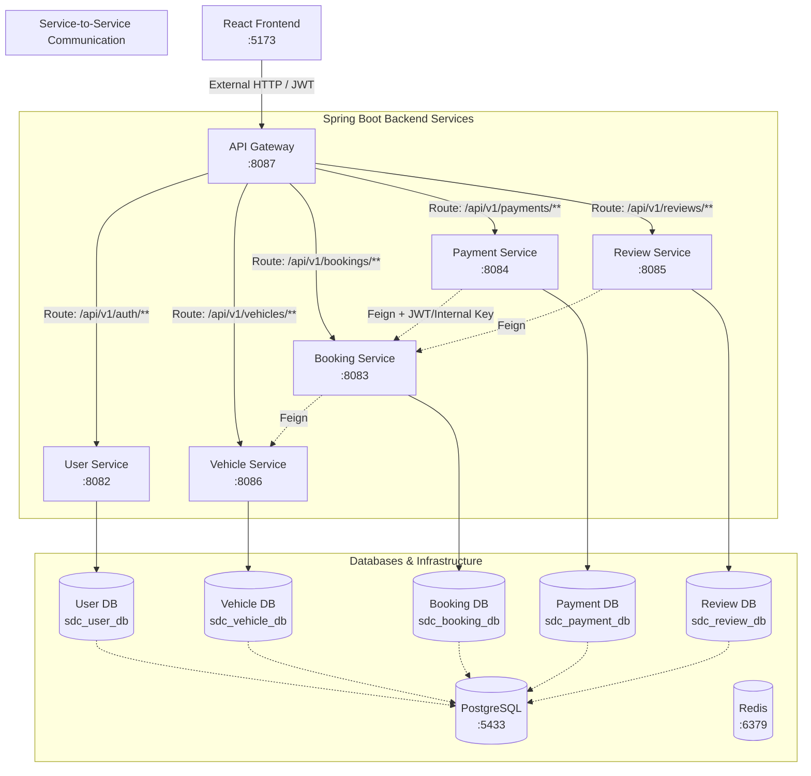
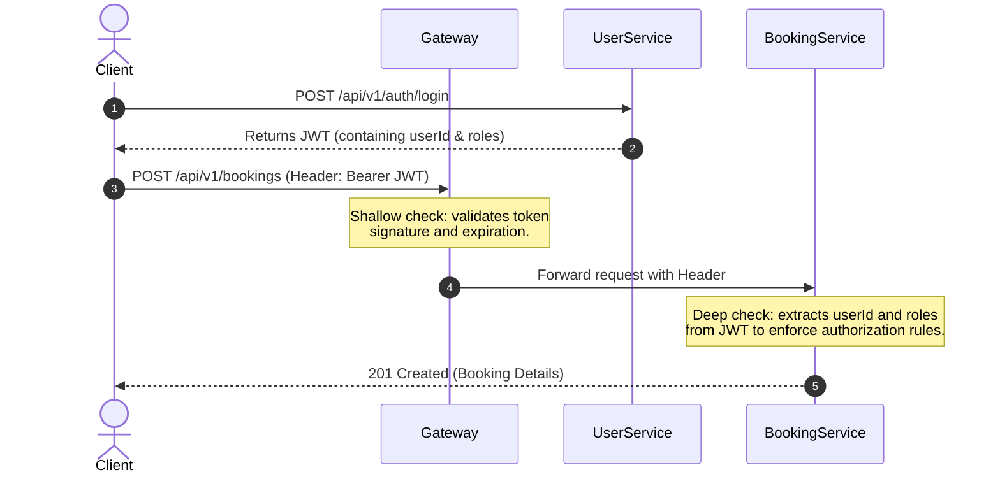

# Project Analysis: SelfDriveConnect

`SelfDriveConnect` is a container-first, Kubernetes-ready peer-to-peer self-drive car rental marketplace microservice application. It connects car owners (supply side) with renters (demand side) through a set of Spring Boot backend services and a React (Vite) frontend.

---

## 🏗️ Overall Architecture

The application is designed using a **Database-per-Service** pattern, decoupling storage and business logic for each domain area. The frontend communicates with the backend services through a single entry point: the **API Gateway**.

---

## 🧱 Microservices Summary

### 1. [api-gateway](file:///c:/Users/Ravi%20Teja/Downloads/SelfDriveConnectLatest/SelfDriveConnect/api-gateway) (Port `8087`)
*   **Role**: Single entry point, routing, centralized CORS control, and shallow JWT pre-checks.
*   **Routing Logic**: Declared via configuration rules (`application.yml`) to proxy requests based on path prefix (e.g., `/api/v1/vehicles/**` -> `vehicle-service`).
*   **Security Pre-check**: Checks signature/expiration of JWTs on protected routes, returning `401 Unauthorized` before forwarding bad requests.
*   **Internal Routing**: Deliberately bypassed by internal service-to-service calls to keep trust boundaries distinct.

### 2. [user-service](file:///c:/Users/Ravi%20Teja/Downloads/SelfDriveConnectLatest/SelfDriveConnect/user-service) (Port `8082`)
*   **Role**: Identity provider, auth management, JWT issuer.
*   **Auth details**: BCrypt-hashed passwords, stateless sessions via Spring Security, multi-role supports (`RENTER`, `OWNER`, `ADMIN`).
*   **Endpoints**:
    *   `POST /api/v1/auth/register` & `POST /api/v1/auth/login` (generates token with `userId` and `roles` claims).
    *   `POST /api/v1/auth/bootstrap-admin` (one-time endpoint protected by `ADMIN_BOOTSTRAP_SECRET` to spin up first admin).
    *   `PATCH /api/v1/users/{id}/roles` (admin-only user role promotion).

### 3. [vehicle-service](file:///c:/Users/Ravi%20Teja/Downloads/SelfDriveConnectLatest/SelfDriveConnect/vehicle-service) (Port `8086`)
*   **Role**: Vehicle inventory, search index, status lifecycle management.
*   **Security**: Validates JWTs, ensures only listing owners can update/delete listings.
*   **Status Transitions**: `PENDING_VERIFICATION` (default) $\rightarrow$ `ACTIVE`/`INACTIVE`/`SUSPENDED`. Listing activation is restricted to the `ADMIN` role.
*   **Endpoints**:
    *   `POST /api/v1/vehicles` (Owner creates listing, ownerId extracted server-side from JWT).
    *   `GET /api/v1/vehicles/search?city=...` (Public, search active vehicles in a city).

### 4. [booking-service](file:///c:/Users/Ravi%20Teja/Downloads/SelfDriveConnectLatest/SelfDriveConnect/booking-service) (Port `8083`)
*   **Role**: Engine for booking operations, availability, and double-booking conflict resolution.
*   **State Machine**: `PENDING` $\rightarrow$ `CONFIRMED` $\rightarrow$ `COMPLETED` or `CANCELLED`.
*   **Integrations**: Uses OpenFeign to query `vehicle-service` to confirm a vehicle is `ACTIVE`.
*   **Core Logic**: Double-booking prevention using overlap detection query: `startA < endB AND startB < endA`.
*   **Endpoints**:
    *   `POST /api/v1/bookings` (Creates booking in `PENDING` state, renterId sourced from JWT, price computed server-side).
    *   `PATCH /api/v1/bookings/{id}/confirm` (Owner / Admin confirms).
    *   `PUT /api/v1/bookings/internal/confirm-after-payment` (Internally invoked by `payment-service` to auto-confirm bookings via a shared API key header).

### 5. [payment-service](file:///c:/Users/Ravi%20Teja/Downloads/SelfDriveConnectLatest/SelfDriveConnect/payment-service) (Port `8084`)
*   **Role**: Simulated payment processing gateway (mock UPI/Card processor).
*   **Security & Safety**: Renter owner validation, duplicate-payment prevention, server-side truth lookup for booking total amount.
*   **Auto-confirmation**: After registering a success payment, calls booking-service's internal confirm endpoint using a shared `X-Internal-Api-Key` to bypass JWT client boundaries.
*   **Simulation**: Supports a `simulateFailure` flag to force transaction failure paths during local testing.

### 6. [review-service](file:///c:/Users/Ravi%20Teja/Downloads/SelfDriveConnectLatest/SelfDriveConnect/review-service) (Port `8085`)
*   **Role**: Rating & review engine.
*   **Trust Rules**: Reviews require verified proof of booking.
    *   Only allows reviews on booking IDs where the caller is the renter, state is `COMPLETED`, and no review exists yet (unique constraint on `bookingId`).
*   **Endpoints**:
    *   `POST /api/v1/reviews` (Submit new review).
    *   `GET /api/v1/reviews/vehicle/{id}/summary` (Calculates live rating average and total count on read path).

---

## 🔒 Security Design

The microservices implement defense-in-depth, combining edge validation with service-level authorization:

*   **Single Identity Provider (IdP)**: Only `user-service` issues token signatures. Downstream services validate tokens using a shared HMAC key (`jwt.secret`).
*   **Request Cleansing**: Downstream services resolve `ownerId` and `renterId` directly from JWT claims rather than trusting request bodies, preventing user impersonation exploits.
*   **API-Key Trust Boundary**: System-to-system operations (like auto-confirming a booking after payment) use a dedicated shared secret (`internal.service-key`) passed via a header. This allows service tasks to be carried out without having to pass a user's JWT.

---

## 💻 Frontend React SPA

The client-side application is built using React with Vite.
*   **Style System**: Implements a dedicated theme in [index.css](file:///c:/Users/Ravi%20Teja/Downloads/SelfDriveConnectLatest/SelfDriveConnect/frontend/src/index.css) utilizing custom CSS variables. It features a modern dark/asphalt theme, signaling yellow accents, and rounded "license-plate" style badges for values like prices and plate numbers.
*   **Routing & Auth State**: Managed through [AuthContext.jsx](file:///c:/Users/Ravi%20Teja/Downloads/SelfDriveConnectLatest/SelfDriveConnect/frontend/src/context/AuthContext.jsx), caching tokens in `localStorage` and decoding them via `jwt-decode` to build role-aware routes (e.g. hiding admin routes or dashboards if they are missing roles).
*   **API Client Layer**: Declared in [client.js](file:///c:/Users/Ravi%20Teja/Downloads/SelfDriveConnectLatest/SelfDriveConnect/frontend/src/api/client.js) where Axios clients route requests to the API Gateway port.

---

## 🔍 Found Discrepancies

1.  **Gateway Port Mismatch**: 
    *   The root [README.md](file:///c:/Users/Ravi%20Teja/Downloads/SelfDriveConnectLatest/SelfDriveConnect/README.md) states that the API Gateway runs on `http://localhost:8080`.
    *   However, both the Gateway's configuration ([application.yml](file:///c:/Users/Ravi%20Teja/Downloads/SelfDriveConnectLatest/SelfDriveConnect/api-gateway/src/main/resources/application.yml#L2)) and the Frontend configurations ([.env](file:///c:/Users/Ravi%20Teja/Downloads/SelfDriveConnectLatest/SelfDriveConnect/frontend/.env#L4) / [client.js](file:///c:/Users/Ravi%20Teja/Downloads/SelfDriveConnectLatest/SelfDriveConnect/frontend/src/api/client.js#L11)) map to port **`8087`**.

---

## 📈 Future Architecture Recommendations

Based on the next steps outline and review of the source code, the system could be evolved by:
1.  **Eureka Service Discovery**: Replace hardcoded URLs in `application.yml` and `FeignClient` annotations with dynamic service-name mapping (e.g. `@FeignClient(name = "booking-service")` dynamically resolved via Eureka instead of using static urls).
2.  **Outbox/Message-Queue Pattern (Event-Driven)**: In `PaymentService.java` (line 106), when the payment transaction succeeds but booking confirmation fails (due to booking-service network issues), the system remains inconsistent. Using a message broker (RabbitMQ/Kafka) would guarantee reliable asynchronous booking confirmation.
3.  **Containerization (Kubernetes)**: Moving hardcoded secrets (`jwt.secret`, `internal.service-key`, etc.) into Kubernetes Secrets/ConfigMaps, containerizing services, and setting up Minikube templates.
